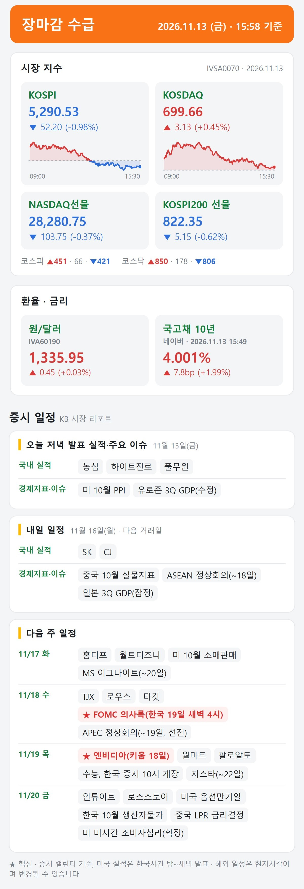
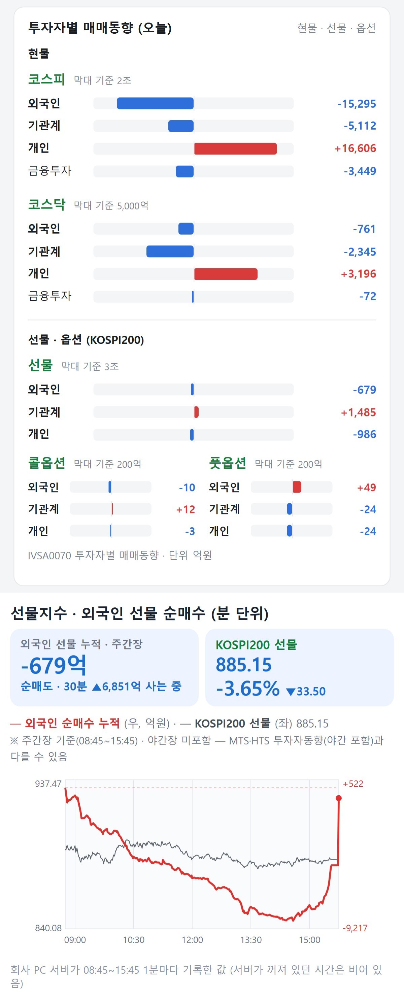
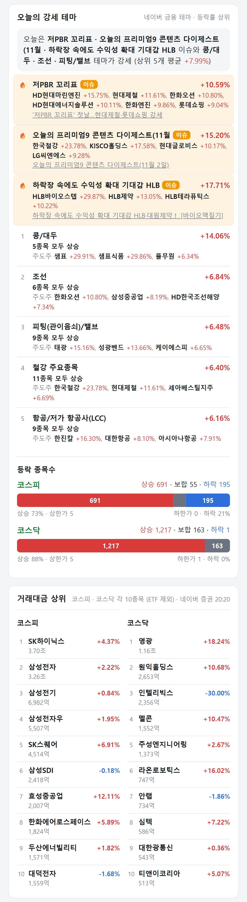

# 26년 11월 3일 국내 장마감 수급 체크

업데이트: 2026-11-03 15:58 (평일 15:50 자동)

```
■ 지수
- 코스피 5,648.79 (▼210.29, -3.59%)
- 코스닥 704.39 (▼29.97, -4.08%)
- 나스닥 선물 28,077.00 (▼50.50, -0.18%)
- 원/달러 1,340.90원 (▼5.10, -0.38%)
- 국고채 10년 4.010% (-3.2bp, -0.79%)

■ 투자자별 매매동향 (억원)
- 코스피: 외국인 -15,295 / 기관 -5,112 / 개인 +16,606
- 코스닥: 외국인 -761 / 기관 -2,345 / 개인 +3,196

■ 선물·옵션 (KOSPI200, 억원)
- KOSPI200 선물 202612 885.15 (▼33.50, -3.65%)
- 선물: 외국인 -679 / 기관 +1,485 / 개인 -986
- 콜옵션: 외국인 -10 / 기관 +12 / 개인 -3
- 풋옵션: 외국인 +49 / 기관 -24 / 개인 -24

■ 오늘의 강세 테마 (네이버 금융 테마 등락률 상위)
오늘은 항공/저가 항공사 · 김밥 · 주류업 테마가 강세였습니다.
1. 항공/저가 항공사(LCC) +3.76% — 9종목 중 6 상승 · 주도주 한진칼 +29.97%, AK홀딩스 +2.27%, 대한항공 +1.92%
2. 김밥(냉동김밥 등) +2.28% — 6종목 중 1 상승 · 주도주 한울앤제주 +29.99%, CJ씨푸드 +0.00%, 사조대림 -0.61%
3. 주류업(주정, 에탄올 등) +2.11% — 13종목 중 6 상승 · 주도주 한울앤제주 +29.99%, 롯데칠성 +1.17%, 하이트진로홀딩스 +1.06%
4. 편의점 +1.88% — 5종목 중 4 상승 · 주도주 BGF리테일 +4.96%, 유성티엔에스 +2.61%, 이마트 +1.62%
5. 제지 +1.73% — 14종목 중 5 상승 · 주도주 깨끗한나라 +29.95%, 에스엠국일 +2.25%, 한국수출포장 +0.96%

■ 등락 종목수
- 코스피: 상승 221 (상한 4) / 보합 61 / 하락 658 (하한 0)
- 코스닥: 상승 322 (상한 3) / 보합 157 / 하락 1,350 (하한 0)

■ 오늘 저녁 발표 실적·주요 이슈
- 국내 실적: LG에너지솔루션 · 포스코퓨처엠 · 하이브 · 한국항공우주
- 미국 실적(한국시간 밤~새벽): AMD(키움 4일) · 암젠 · 아리스타 · 화이자 · 부킹
- 경제지표·이슈: 미국 중간선거(한국 4일 개표) · 한국 10월 소비자물가 · 일본 휴장
- 행사: 신규상장 래블업

■ 내일 일정 · 11월 4일(수)
- 국내 실적: 한화 · 카카오뱅크 · 현대백화점
- 미국 실적(한국시간 밤~새벽): 맥도날드 · 우버 · CVS · 데이터독 · 노보노디스크
- 경제지표·이슈: 미 ISM 서비스업 PMI · 미 10월 ADP 고용
- 행사: 로보월드(~7일) · 신규상장 이에스티

■ 금주의 일정
- 11/5 목: 카카오 · LG화학 · 에코프로비엠 · KT&G · 퀄컴 · 코노코필립스 · 루멘텀 · 도요타 · 소니 · 닌텐도 · BOE 통화정책회의 · 중국 수입박람회(~10일)
- 11/6 금: 한국콜마 · 롯데쇼핑 · 강원랜드 · 모더나 · 휴매나 · 미쓰비시중공업 · 혼다 · 미 10월 고용보고서 · 미 미시간 소비자심리(잠정)
(★ 핵심 · 증시 캘린더 기준, 해외 일정은 현지시각이며 변경될 수 있습니다)

▶ 한 줄 요약: 외국인 현물·선물 동반 순매도, 코스피 -3.59% 하락 마감

(데이터: KB증권 OpenAPI · 2026-11-03 15:58 기준)
```







## 파일
- [latest/장마감 수급체크.html](latest/) — 내려받아(Download raw) 브라우저로 열면 차트 확대·체크박스·값 확인 가능
- [archive/](archive/) — 날짜별 기록
