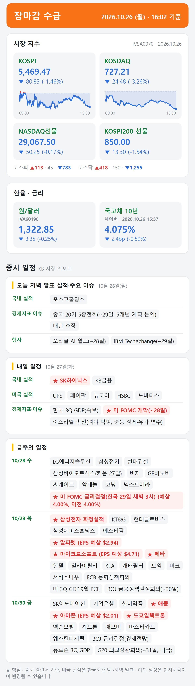
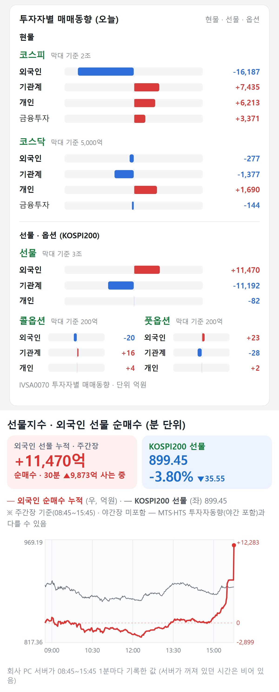
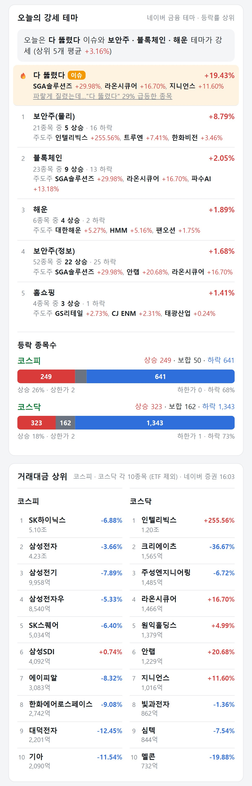

# 26년 10월 13일 국내 장마감 수급 체크

업데이트: 2026-10-13 16:44 (평일 15:50 자동)

```
■ 지수
- 코스피 6,035.35 (▼348.89, -5.46%)
- 코스닥 837.03 (▼12.16, -1.43%)
- 나스닥 선물 30,660.75 (▼237.50, -0.77%)
- 원/달러 1,342.10원 (▲6.30, +0.47%)
- 국고채 10년 4.252% (-6.7bp, -1.55%)

■ 투자자별 순매수 (억원)
- 코스피: 외국인 -45,423 / 기관 +16,900 / 개인 +22,420
- 코스닥: 외국인 +1,390 / 기관 +437 / 개인 -1,910

■ 선물·옵션 (KOSPI200, 억원)
- KOSPI200 선물 202612 944.80 (▼63.45, -6.29%)
- 선물: 외국인 +3,897 / 기관 -5,278 / 개인 +1,237
- 콜옵션: 외국인 -28 / 기관 +11 / 개인 +7
- 풋옵션: 외국인 -42 / 기관 -17 / 개인 +52

■ 오늘의 강세 테마 (네이버 금융 테마 등락률 상위)
오늘은 요소수 · 시멘트/레미콘 · 니켈 테마가 강세였습니다.
1. 요소수 +2.89% — 5종목 중 3 상승 · 주도주 유니온머티리얼 +11.82%, 유니온 +3.38%, KG케미칼 +0.75%
2. 시멘트/레미콘 +2.40% — 15종목 중 8 상승 · 주도주 서산 +29.88%, HC보광산업 +12.17%, 부산산업 +4.90%
3. 니켈 +1.85% — 14종목 중 6 상승 · 주도주 대양금속 +21.98%, 이지트로닉스 +7.59%, 포스코인터내셔널 +2.55%
4. 태풍 및 장마 +1.78% — 10종목 중 6 상승 · 주도주 뉴보텍 +10.71%, 하이드로리튬 +4.57%, 파루 +1.81%
5. 육계 +1.42% — 9종목 중 5 상승 · 주도주 마니커에프앤지 +8.30%, 체리부로 +3.81%, 마니커 +2.61%

■ 등락 종목수
- 코스피: 상승 254 (상한 0) / 보합 57 / 하락 632 (하한 0)
- 코스닥: 상승 544 (상한 8) / 보합 158 / 하락 1,117 (하한 0)

■ 오늘 저녁 발표 실적·주요 이슈
- 미국 실적(한국시간 밤~새벽): JP모건 · 골드만삭스 · 씨티 · 웰스파고 · 존슨앤존슨 · 유나이티드헬스
- 행사: 세미콘 웨스트(~15일)

■ 내일 일정 · 10월 14일(수)
- 국내 실적: 한미반도체
- 미국 실적(한국시간 밤~새벽): ASML · BoA · 모건스탠리
- 경제지표·이슈: ★미 9월 소비자물가(CPI) · 연준 베이지북(한국 15일 새벽 3시) · 중국 9월 물가·수출입
- 행사: 신규상장 멜콘 · 반도체대전 SEDEX(~16일)

■ 금주의 일정
- 10/15 목: ★TSMC · 애보트 · 유나이티드항공 · US뱅코프 · 미 9월 PPI·소매판매 · EU 정상회의(~16일) · G20 재무장관·중앙은행 총재 회의 · 신규상장 진코스텍
- 10/16 금: 찰스슈왑 · SLB · CSX · 미국 옵션만기일 · 미 9월 산업생산 · 한국 9월 실업률
(★ 핵심 · 증시 캘린더 기준, 해외 일정은 현지시각이며 변경될 수 있습니다)

▶ 한 줄 요약: 외국인 현물 순매도·선물 순매수, 코스피 -5.46% 하락 마감

(데이터: KB증권 OpenAPI · 2026-10-13 16:44 기준)
```







## 파일
- [latest/장마감 수급체크.html](latest/) — 내려받아(Download raw) 브라우저로 열면 차트 확대·체크박스·값 확인 가능
- [archive/](archive/) — 날짜별 기록
