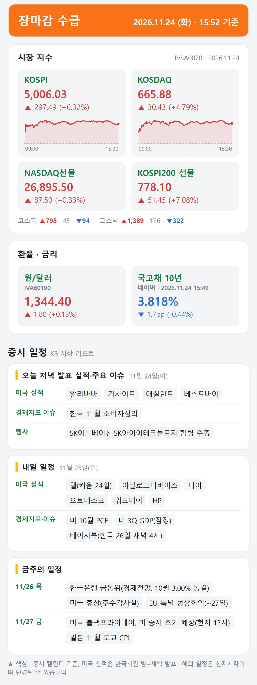
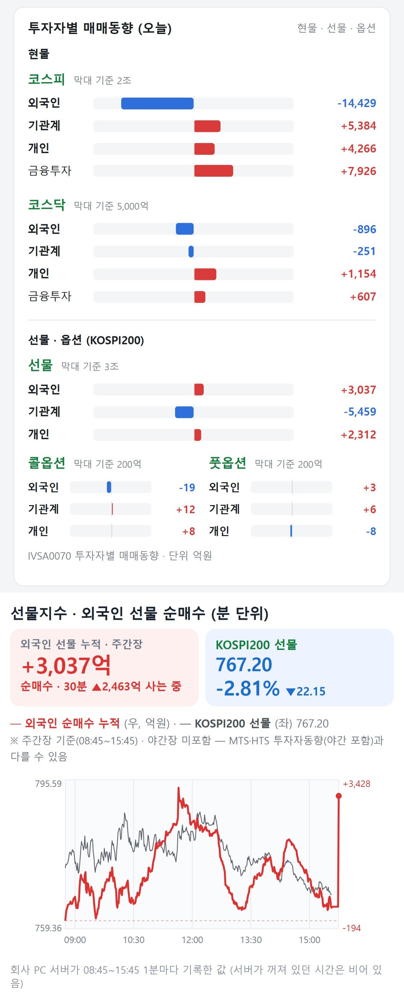

# 26년 11월 19일 국내 장마감 수급 체크

업데이트: 2026-11-19 15:52 (평일 15:50 자동)

```
■ 지수
- 코스피 5,103.37 (▲35.93, +0.71%)
- 코스닥 676.80 (▲13.99, +2.11%)
- 나스닥 선물 27,625.00 (▲438.25, +1.61%)
- 원/달러 1,329.85원 (▼3.85, -0.29%)
- 국고채 10년 3.944% (-1.9bp, -0.48%)

■ 투자자별 매매동향 (억원)
- 코스피: 외국인 -4,248 / 기관 +192 / 개인 -385
- 코스닥: 외국인 -1,744 / 기관 +1,132 / 개인 +624

■ 선물·옵션 (KOSPI200, 억원)
- KOSPI200 선물 202612 791.85 (▲5.40, +0.69%)
- 선물: 외국인 +164 / 기관 -757 / 개인 +382
- 콜옵션: 외국인 -4 / 기관 +8 / 개인 -4
- 풋옵션: 외국인 -9 / 기관 +3 / 개인 +5

■ 오늘의 강세 테마 (네이버 금융 테마 등락률 상위)
오늘은 여행 · 영상콘텐츠 · 홈쇼핑 테마가 강세였습니다.
1. 여행 +9.05% — 9종목 중 8 상승 · 주도주 노랑풍선 +29.98%, 참좋은여행 +17.67%, 하나투어 +16.26%
2. 영상콘텐츠 +7.69% — 31종목 중 26 상승 · 주도주 에이스토리 +30.00%, 스튜디오드래곤 +29.96%, 자이언트스텝 +29.95%
3. 홈쇼핑 +7.03% — 4종목 중 2 상승 · 주도주 CJ ENM +27.16%, 롯데쇼핑 +0.96%, GS리테일 +0.00%
4. 면세점 +6.16% — 8종목 모두 상승 · 주도주 토니모리 +15.87%, 호텔신라 +10.30%, 신세계 +10.28%
5. 음원/음반 +5.89% — 15종목 모두 상승 · 주도주 CJ ENM +27.16%, 하이브 +13.21%, YG PLUS +12.50%

■ 등락 종목수
- 코스피: 상승 509 (상한 1) / 보합 71 / 하락 358 (하한 0)
- 코스닥: 상승 1,050 (상한 11) / 보합 173 / 하락 612 (하한 0)

■ 오늘 저녁 발표 실적·주요 이슈
- 미국 실적(한국시간 밤~새벽): ★엔비디아(키움 18일) · 월마트 · 팔로알토
- 경제지표·이슈: 수능, 한국 증시 10시 개장
- 행사: 지스타(~22일)

■ 내일 일정 · 11월 20일(금)
- 미국 실적(한국시간 밤~새벽): 인튜이트 · 로스스토어
- 경제지표·이슈: 미국 옵션만기일 · 한국 10월 생산자물가 · 중국 LPR 금리결정 · 미 미시간 소비자심리(확정)
(★ 핵심 · 증시 캘린더 기준, 해외 일정은 현지시각이며 변경될 수 있습니다)

▶ 한 줄 요약: 외국인 현물 순매도·선물 순매수, 코스피 +0.71% 상승 마감

(데이터: KB증권 OpenAPI · 2026-11-19 15:52 기준)
```






## 파일
- [latest/장마감 수급체크.html](latest/) — 내려받아(Download raw) 브라우저로 열면 차트 확대·체크박스·값 확인 가능
- [archive/](archive/) — 날짜별 기록
