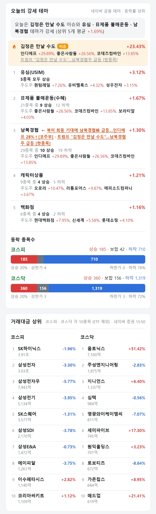

# 26년 11월 24일 국내 장마감 수급 체크

업데이트: 2026-11-24 15:52 (평일 15:50 자동)

```
■ 지수
- 코스피 5,006.03 (▲297.49, +6.32%)
- 코스닥 665.88 (▲30.43, +4.79%)
- 나스닥 선물 26,895.50 (▲87.50, +0.33%)
- 원/달러 1,344.40원 (▲1.80, +0.13%)
- 국고채 10년 3.818% (-1.7bp, -0.44%)

■ 투자자별 매매동향 (억원)
- 코스피: 외국인 +7,393 / 기관 +8,690 / 개인 -20,430
- 코스닥: 외국인 +1,188 / 기관 +2,068 / 개인 -3,085

■ 선물·옵션 (KOSPI200, 억원)
- KOSPI200 선물 202612 778.10 (▲51.45, +7.08%)
- 선물: 외국인 +7,115 / 기관 -7,456 / 개인 +347
- 콜옵션: 외국인 +119 / 기관 -39 / 개인 -90
- 풋옵션: 외국인 +4 / 기관 +9 / 개인 -10

■ 오늘의 강세 테마 (네이버 금융 테마 등락률 상위)
오늘은 피지컬 AI/휴머노이드 로봇 · 로봇 · 자동차 대표주 테마가 강세였습니다.
1. 피지컬 AI/휴머노이드 로봇 +10.24% — 49종목 중 47 상승 · 주도주 현대오토에버 +29.93%, 한국피아이엠 +29.87%, 유진로봇 +20.63%
2. 로봇(산업용/협동로봇 등) +9.91% — 77종목 중 72 상승 · 주도주 KH바텍 +29.96%, 휴림로봇 +29.90%, 아이티엠반도체 +29.88%
3. 자동차 대표주 +9.70% — 7종목 모두 상승 · 주도주 현대모비스 +14.51%, HL만도 +13.06%, 현대차 +11.11%
4. MLCC(적층세라믹콘덴서) +9.37% — 11종목 중 10 상승 · 주도주 아모텍 +23.33%, 대주전자재료 +13.29%, 코스모신소재 +11.83%
5. IT 대표주 +8.85% — 6종목 모두 상승 · 주도주 LG전자 +15.86%, 삼성SDI +13.64%, SK하이닉스 +6.73%

■ 등락 종목수
- 코스피: 상승 798 (상한 2) / 보합 45 / 하락 94 (하한 0)
- 코스닥: 상승 1,389 (상한 10) / 보합 126 / 하락 322 (하한 0)

■ 오늘 저녁 발표 실적·주요 이슈
- 미국 실적(한국시간 밤~새벽): 알리바바 · 키사이트 · 애질런트 · 베스트바이
- 경제지표·이슈: 한국 11월 소비자심리
- 행사: SK이노베이션·SK아이이테크놀로지 합병 주총

■ 내일 일정 · 11월 25일(수)
- 미국 실적(한국시간 밤~새벽): 델(키움 24일) · 아날로그디바이스 · 디어 · 오토데스크 · 워크데이 · HP
- 경제지표·이슈: 미 10월 PCE · 미 3Q GDP(잠정) · 베이지북(한국 26일 새벽 4시)

■ 금주의 일정
- 11/26 목: 한국은행 금통위(경제전망, 10월 3.00% 동결) · 미국 휴장(추수감사절) · EU 특별 정상회의(~27일)
- 11/27 금: 미국 블랙프라이데이, 미 증시 조기 폐장(현지 13시) · 일본 11월 도쿄 CPI
(★ 핵심 · 증시 캘린더 기준, 해외 일정은 현지시각이며 변경될 수 있습니다)

▶ 한 줄 요약: 외국인 현물·선물 동반 순매수, 코스피 +6.32% 상승 마감

(데이터: KB증권 OpenAPI · 2026-11-24 15:52 기준)
```




## 파일
- [latest/장마감 수급체크.html](latest/) — 내려받아(Download raw) 브라우저로 열면 차트 확대·체크박스·값 확인 가능
- [archive/](archive/) — 날짜별 기록
